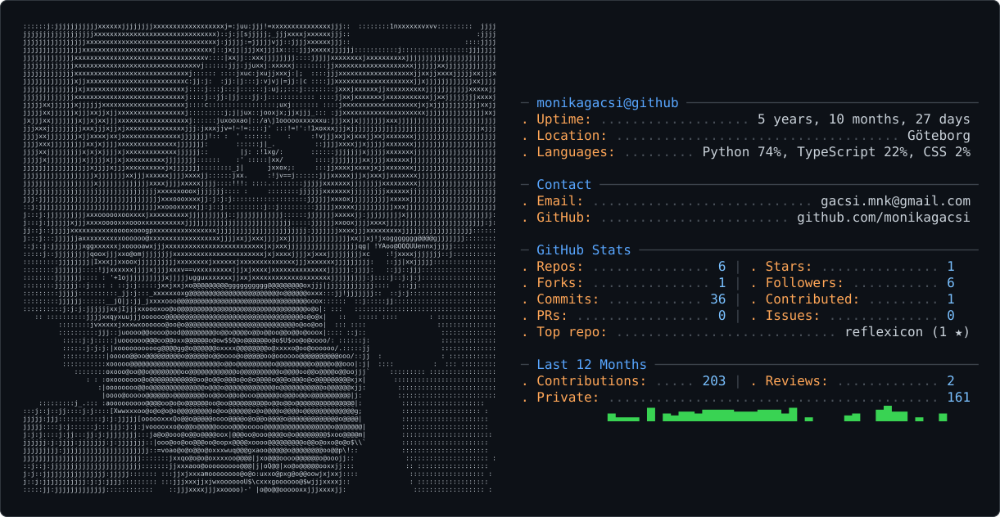

<picture>
  <source media="(prefers-color-scheme: dark)" srcset="dark_mode.svg" />
  <source media="(prefers-color-scheme: light)" srcset="light_mode.svg" />
  
</picture> 

# Hi there 🌊
I'm **Mónika Gácsi**, a QA Engineer and currently a **_Software Engineering student_** at the **_University of Gothenburg_**. 

- 🔭 I’m currently working on a secret side project 🤫
- 🌱 I’m currently learning OOP and Playwright
- 💬 Ask me about test case design, release ownership and of course, _the raccoon_
- ⚡ Fun fact: I was an archaeologist before QA, so I'm comfortable with old code, buried layers, and things that should have been documented better
<!-- - 👯 I’m looking to collaborate on ...
- 🤔 I’m looking for help with ... -->

---
### 🔎 QA Experience & Projects
**ISTQB-certified** with nearly **4 years** of experience **testing web applications, APIs**, and SaaS platforms in fast-paced startup environments. Primarily focused on **functional, regression, and end-to-end testing**, including negative testing, permissions, data persistence, and API validation, with **exploratory testing** through extended bug bashes. Experienced in release coordination and ownership, from planning and defect tracking to QA sign-off.

Hands-on experience with SQL (PostgreSQL, MySQL), Postman (REST API testing), Cypress, JavaScript, and TypeScript, alongside exposure to Playwright and AI-assisted testing using Claude Code.

* **[Test Case Generator](https://github.com/monikagacsi/test-case-generator)** — Turns user stories and OpenAPI 3 specs into functional, negative, edge, boundary, and API test cases using Gemini/Ollama, Streamlit, and SQLite, with schema validation, duplicate/low-value flagging, and a human review queue so QA decides what gets accepted and exported.
* **[API Testing Project](https://github.com/monikagacsi/api-testing)** — Postman and Newman suites for Petstore and Restful-Booker covering CRUD, auth, and negative/boundary/security cases, with test design docs and execution reports.
* **[Playwright E2E Practice:](https://github.com/monikagacsi/webdriveruni-playwright-practice)** — UI automation in Playwright and TypeScript against WebDriverUniversity, covering forms, dropdowns/checkboxes/radios, autocomplete, popups/alerts, and a to-do list, with the Page Object Model and a configurable base URL for running across environments.

<!-- * **[Workflow or Tooling Repo]** — Brief description (e.g., CI/CD test execution or AI-assisted review experiment). -->
### 🛠️ Tech Stack
`TypeScript` `JavaScript` `Python` `Cypress` `Playwright` `SQL` `APIs` `GitHub Actions`

---
### 💻 SoftEng Projects
At _**Works-as-Implemented Corp**_, we firmly believe in **SaF (Software as Fun)**. Why shouldn't our apps make life easier *and* a little more whimsical? We think they can do both. 
Our core values are curiosity, tidy commit messages. 
The only cookies we handle are at fika, though honestly we'd pick a _kanelbulle_ over any of them. 
<!-- * **Portfolio:** [Your Portfolio Link](#) *(or remove this line until your site is live)* -->
* **[Reflexicon](https://github.com/monikagacsi/reflexicon)** - Every coding course makes you check for palindromes, but nobody ever invites their neglected cousin, the semordnilap (a word that spells another word backwards). Reflexicon tells you whether your word is a palindrome, a semordnilap, or neither, and confirms the semordnilaps against a real dictionary. Built with **HTML, CSS, JavaScript**, and the **Free Dictionary API**.
<!-- * **[App / System Repo 2]** — What you built and what problem it solves. -->

